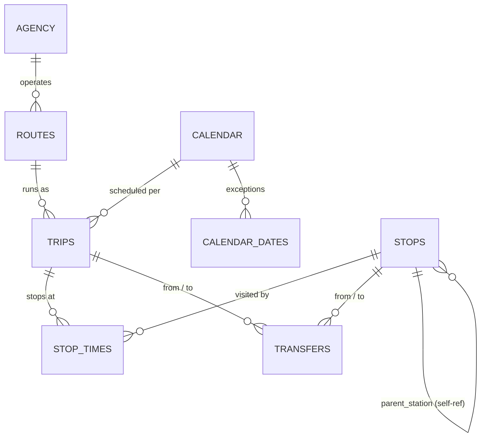

# 🚉 RailPulse: Belgian Transit SQL Analysis

I built this project to dig into the operational reality of the Belgian National Railway (SNCB/NMBS) network — not the marketing version, the actual schedule data. It started as a BeCode bootcamp challenge, but I treated it like a real consulting mandate: I pulled SNCB's official GTFS static feed, normalized it into a clean SQLite database with proper primary and foreign keys, and then answered five concrete operational questions using nothing but SQL — no pandas doing the filtering or aggregating for me, on purpose, because the whole point was to actually get fluent in `JOIN`, `GROUP BY`, `CASE WHEN`, and reading an `EXPLAIN QUERY PLAN` rather than leaning on a dataframe to hide the work. Along the way I also pushed past the required scope: a live-ingestion loop against the real-time iRail API, a visual on-time leaderboard across five major hubs, index optimization I actually benchmarked rather than just claimed, and a Streamlit dashboard on top of it all.

---

## 📋 Table of Contents

1. [Project Description](#-project-description)
2. [Repository Structure](#️-repository-structure)
3. [Entity-Relationship Diagram](#-entity-relationship-diagram)
4. [Setup & How to Run](#️-setup--how-to-run)
5. [Key Findings](#-key-findings)
6. [Dashboard](#-dashboard)
7. [Nice-to-Have Features](#-nice-to-have-features)
8. [What Changed From the Earlier Draft](#-what-changed-from-the-earlier-draft)
9. [Tech Stack](#️-tech-stack)
10. [Contributors](#-contributors)
11. [Personal Situation](#-personal-situation)
12. [Conclusion](#-conclusion)

---

## 📋 Project Description

This project started from a fictional mission brief: I'm playing the role of a data consultant at **RailPulse**, hired by the Belgian National Railway (SNCB/NMBS) to give them a clear picture of operational performance ahead of winter scheduling — where the bottlenecks are, which hours and platforms are under the most pressure, and how well the network's amenity data (wheelchair access, bike storage) actually holds up when you query it for real.

Instead of building purely off the iRail live API as the brief first suggested, I built the core database from SNCB's **static GTFS feed** (agencies, routes, trips, stop times, calendars, transfers as flat `.txt` files) — it gives a complete, stable network-wide picture to answer the five required questions against, rather than whatever happens to be running at query time. I kept the live iRail API for what it's actually good at: a separate `live_departures` table for the real-time nice-to-haves, so it never mixes with the scheduled GTFS data.

### My approach

Roughly following the steps laid out in the brief:

1. **Read the docs, designed the schema** — mapped the GTFS spec into 10 normalized SQLite tables with proper primary/foreign keys, diagrammed with [drawdb.app](https://www.drawdb.app/).
2. **Wrote the ingestion script** (`main.py`) — parses the raw `.txt` files with `csv.DictReader` and loads them with idempotent `INSERT ... ON CONFLICT DO NOTHING`, so re-running it never duplicates rows.
3. **Answered the 5 core questions** in dedicated `.sql` files under `sql/`, run and printed via `src/run_queries.py` — SQL only, no pandas in the analytical layer.
4. **Scaled up for the nice-to-haves** — added `src/live_ingest.py` for a real (if short) historical timeline, `src/network_leaderboard.py` for the hub comparison, and `src/optimize_indexes.py` to actually prove the index speed-up with `EXPLAIN QUERY PLAN` rather than just claim it.
5. **Built a dashboard** — `dashboard.py`, a Streamlit view of Bruxelles-Central operations, wired directly to the same `railpulse.db` the SQL queries run against.

Along the way I hit (and fixed) a few real problems worth being upfront about: an early version had two incompatible ingestion schemas running in parallel (see [What Changed](#-what-changed-from-the-earlier-draft)), the wheelchair-accessibility field turned out to be entirely unpublished in the feed rather than genuinely all-zero, and my first cut at the accessibility query didn't actually answer what was asked. I'd rather document those corrections than hide them.

---

## 🗂️ Repository Structure

```
railpulse_sql_analysis/
├── data/
├── docs/
│   ├── ERD.png
│   └── network_leaderboard.png
├── sql/
│   ├── 01_peak_hour.sql
│   ├── 02_platform_bottlenecks.sql
│   ├── 03_busiest_morning_destinations.sql
│   ├── 04_service_frequency.sql
│   ├── 05_accessibility_audit.sql
│   └── 06_bikes_allowed_by_route.sql
├── src/
│   ├── run_queries.py
│   ├── check_accessibility_fields.py
│   ├── live_ingest.py
│   ├── fix_station_names.py
│   ├── network_leaderboard.py
│   ├── optimize_indexes.py
│   └── ingest_gtfs.py
├── main.py
├── dashboard.py
├── run_all.py
├── run_railpulse.bat
├── requirements.txt
└── README.md
```

### What each file does

| File | Role |
| --- | --- |
| `main.py` | **Canonical ingestion script.** Creates the GTFS schema (10 tables) in `data/railpulse.db` and loads every `data/*.txt` GTFS file into it with `INSERT ... ON CONFLICT DO NOTHING` (idempotent — safe to re-run). Also drops/rebuilds indexes around the bulk import for speed and runs a foreign-key integrity check at the end. |
| `dashboard.py` | Streamlit app giving a quick operational view of Bruxelles-Central: total scheduled stops, unique trips/routes, a departures-by-hour bar chart, and a raw-data browser. Reads directly from `data/railpulse.db`. |
| `run_railpulse.bat` | Convenience script for Windows: activates the project's virtual environment, runs `main.py`, then `src/run_all.py`, then launches `streamlit run dashboard.py`. |
| `src/run_queries.py` | Executes `sql/01_peak_hour.sql` through `sql/06_bikes_allowed_by_route.sql` against the database and prints formatted results — this is what produces the tables in [Key Findings](#-key-findings). |
| `src/check_accessibility_fields.py` | Diagnostic script confirming whether `wheelchair_accessible` and `bikes_allowed` are actually populated in the feed (they aren't, for wheelchair — see Q5). |
| `src/live_ingest.py` | Nice-to-have: pulls current departures for 5 major hubs from the iRail real-time API and appends them to a `live_departures` table, tagged with `pulled_at`. |
| `src/fix_station_names.py` | Cleans inconsistent `station_name` values written by `live_ingest.py`. |
| `src/network_leaderboard.py` | Nice-to-have: ranks the 5 hubs by on-time percentage using `live_departures` history and saves a chart to `docs/network_leaderboard.png`. |
| `src/optimize_indexes.py` | Nice-to-have: runs `EXPLAIN QUERY PLAN` on the heaviest query (`01_peak_hour.sql`) before/after adding indexes, to demonstrate the performance impact. |
| `src/run_all.py` | Orchestrator: always runs `run_queries.py` and `optimize_indexes.py`; with `--live`, also runs `live_ingest.py` and `network_leaderboard.py`. |
| `src/ingest_gtfs.py` | **Deprecated.** An earlier ingestion script with a slightly different (PascalCase) schema. `main.py` at the repo root is now the single source of truth for ingestion — this file is kept only for history and is not called by `run_railpulse.bat` or `run_all.py`. |

---

## 📐 Entity-Relationship Diagram




**Foreign keys, in plain terms:**

| Table | Points to | Meaning |
| --- | --- | --- |
| `routes.agency_id` | `agency.agency_id` | which company runs the route |
| `trips.route_id` | `routes.route_id` | which route a trip belongs to |
| `trips.service_id` | `calendar.service_id` | which weekly schedule pattern applies |
| `calendar_dates.service_id` | `calendar.service_id` | one-off exceptions to that pattern (e.g. holidays) |
| `stop_times.trip_id` | `trips.trip_id` | which trip this stop-time row belongs to |
| `stop_times.stop_id` | `stops.stop_id` | which physical stop/platform |
| `transfers.from_stop_id` / `to_stop_id` | `stops.stop_id` | transfer connection between two stops |
| `transfers.from_trip_id` / `to_trip_id` | `trips.trip_id` | transfer connection between two trips |
| `stops.parent_station` | `stops.stop_id` (self-reference) | a platform points back to its parent station — this is what `02_platform_bottlenecks.sql` uses to resolve Bruxelles-Central's platforms |

`agency`, `feed_info`, and `translations` sit outside this chain — `feed_info` and `translations` have no foreign keys at all (feed-level metadata / i18n lookup tables), and `agency` is only ever referenced *from* `routes`.

---

## ⚙️ Setup & How to Run

**Quickest way (Windows):** once your virtual environment exists (see below), just double-click `run_railpulse.bat`, or run it from a terminal:

```bat
run_railpulse.bat
```

It chains everything in one go: builds/updates `data/railpulse.db` from the raw GTFS files (`main.py`), runs the full SQL analysis + index benchmarking pipeline (`src/run_all.py`), and launches the Streamlit dashboard at the end — no need to run each step manually.

**Manual / step-by-step (any OS):**

```bash
python -m venv .venv
.venv\Scripts\activate        # Windows
pip install -r requirements.txt

python main.py                # builds data/railpulse.db from data/*.txt
python src/run_all.py         # runs the 5 (+1 bonus) SQL analyses, then index benchmarking
python src/run_all.py --live  # also runs the live-ingest + leaderboard nice-to-haves
streamlit run dashboard.py    # launches the dashboard at http://localhost:8501
```

---

## 📊 Key Findings

> Confirmed against a real run of `main.py` + `src/run_all.py` via `run_railpulse.bat`. Import counts show `Imported: 0` on this run because the database already existed and `INSERT OR IGNORE` correctly skipped rows already present — this is the expected idempotent behavior, not a failure.

### 1. Peak hour

*Which hour of the day experiences the highest volume of scheduled train departures across the entire network?*

| departure_hour | total_departures |
| --- | --- |
| **10** | **138,949** |
| 09 | 135,384 |
| 11 | 135,156 |

**Answer: 10 AM** is the network-wide peak hour.

### 2. Platform bottlenecks — Bruxelles-Central

*Top 3 busiest platforms at Bruxelles-Central.*

| platform_code | stop_name | total_operations |
| --- | --- | --- |
| **3** | Bruxelles-Central | **11,982** |
| 4 | Bruxelles-Central | 10,515 |
| 2 | Bruxelles-Central | 7,473 |

**Answer: Platform 3** handles the most operations.

### 3. Busiest morning destinations

*Top 3 terminal destinations (`trip_headsign`) for trips departing before 12:00:00.*

| trip_headsign | trip_count |
| --- | --- |
| **Anvers-Central** | **3,930** |
| Bruxelles-Midi | 3,145 |
| Louvain | 2,505 |

### 4. Service frequency

*Classify each `service_id` into High / Medium / Low-Frequency-Special by days-per-week active, via `CASE WHEN`, and show the share per category.*

| frequency_category | service_count | percentage_share |
| --- | --- | --- |
| Low Frequency/Special | 50,317 | 97.53% |
| Medium Frequency | 878 | 1.70% |
| High Frequency | 398 | 0.77% |

The vast majority of `service_id`s in the feed are one-off or irregular patterns (holidays, exceptions, single-date services) rather than genuine weekly-recurring schedules.

### 5. Accessibility audit

*Ratio/percentage of trips per route that guarantee wheelchair accessibility or bikes-allowed; which routes score lowest?*

**⚠️ Data limitation, not a real finding:** `trips.wheelchair_accessible` is empty (not even `0`) for all 134,809 trips in this feed, confirmed via `src/check_accessibility_fields.py`. SNCB does not publish accessibility info in this static feed, so `wheelchair_accessible_pct = 0.0%` is a data-availability artifact — it does not mean 0% of the network is actually wheelchair-accessible.

| route_short_name | route_long_name | total_trips | wheelchair_accessible_pct | bikes_allowed_pct | either_amenity_pct |
| --- | --- | --- | --- | --- | --- |
| IC | Anvers-Central — Charleroi-Central | 3,081 | 0.0% | 100.0% | 100.0% |
| S2 | Louvain — Braine-le-Comte | 2,674 | 0.0% | 100.0% | 100.0% |
| IC | Eupen — Ostende | 2,210 | 0.0% | 100.0% | 100.0% |
| S10 | Termonde — Alost | 1,782 | 0.0% | 100.0% | 100.0% |
| IC | Brussels Airport-Zaventem — Gand-Saint-Pierre | 1,734 | 0.0% | 100.0% | 100.0% |
| IC | Anvers-Central — Hasselt | 1,649 | 0.0% | 100.0% | 100.0% |
| IC | Liège-Guillemins — Knokke | 1,577 | 0.0% | 100.0% | 100.0% |
| IC | Brussels Airport-Zaventem — Mons | 1,569 | 0.0% | 100.0% | 100.0% |
| IC | Luxembourg (LU) — Bruxelles-Midi | 1,435 | 0.0% | 100.0% | 100.0% |
| IC | Bruxelles-Midi — Anvers-Central | 1,398 | 0.0% | 100.0% | 100.0% |
| S1 | Nivelles — Anvers-Central | 1,350 | 0.0% | 100.0% | 100.0% |
| EC | Rotterdam Centraal (NL) — Bruxelles-Midi | 1,191 | 0.0% | 100.0% | 100.0% |
| IC | Brussels Airport-Zaventem — Tournai | 1,167 | 0.0% | 100.0% | 100.0% |
| IC | Bruxelles-Midi — Arlon | 1,092 | 0.0% | 100.0% | 100.0% |
| IC | Lille Flandres (FR) — Anvers-Central | 1,080 | 0.0% | 100.0% | 100.0% |

**Reading this table honestly:** every major route in this ranked list actually shows **100%** `either_amenity_pct`, not 0% — because `bikes_allowed` is fully populated on every one of these high-volume routes (confirmed independently in section 6 below). In other words, under this query's filters (excludes bus-branded routes, requires >5 trips), none of the large IC/S/EC routes are genuinely underserved on bikes; wheelchair data simply isn't published at all. If any route is a true low performer on `bikes_allowed`, it is a smaller or bus-tagged route excluded by these filters — see the note at the end of section 6 for how to find it.

Network-wide (all 134,809 trips):

| Field | Flagged / positive | Blank / no data |
| --- | --- | --- |
| `wheelchair_accessible` | 0 (0.00%) | 134,809 (100.00%) |
| `bikes_allowed` | 123,051 (91.28%) | 11,758 (8.72%) |

### 6. Bikes allowed coverage by route (bonus, not a required question)

*Is `bikes_allowed` genuinely populated per route, or concentrated in a few problem routes?*

| route_short_name | route_long_name | total_trips | flagged_trips | unflagged_trips | unflagged_pct |
| --- | --- | --- | --- | --- | --- |
| IC | Anvers-Central — Charleroi-Central | 3,081 | 3,081 | 0 | 0.0% |
| S2 | Louvain — Braine-le-Comte | 2,674 | 2,674 | 0 | 0.0% |
| IC | Eupen — Ostende | 2,210 | 2,210 | 0 | 0.0% |
| S10 | Termonde — Alost | 1,782 | 1,782 | 0 | 0.0% |
| IC | Brussels Airport-Zaventem — Gand-Saint-Pierre | 1,734 | 1,734 | 0 | 0.0% |
| IC | Anvers-Central — Hasselt | 1,649 | 1,649 | 0 | 0.0% |
| IC | Liège-Guillemins — Knokke | 1,577 | 1,577 | 0 | 0.0% |
| IC | Brussels Airport-Zaventem — Mons | 1,569 | 1,569 | 0 | 0.0% |
| IC | Luxembourg (LU) — Bruxelles-Midi | 1,435 | 1,435 | 0 | 0.0% |
| IC | Bruxelles-Midi — Anvers-Central | 1,398 | 1,398 | 0 | 0.0% |
| S1 | Nivelles — Anvers-Central | 1,350 | 1,350 | 0 | 0.0% |
| EC | Rotterdam Centraal (NL) — Bruxelles-Midi | 1,191 | 1,191 | 0 | 0.0% |
| IC | Brussels Airport-Zaventem — Tournai | 1,167 | 1,167 | 0 | 0.0% |
| IC | Bruxelles-Midi — Arlon | 1,092 | 1,092 | 0 | 0.0% |
| IC | Lille Flandres (FR) — Anvers-Central | 1,080 | 1,080 | 0 | 0.0% |

**Takeaway:** the 11,758 network-wide blank `bikes_allowed` trips are not spread across the mainline network — every one of the top 15 routes by volume shows 0% unflagged. The gaps must sit in routes these filters exclude (bus-branded routes, or services with 5 or fewer trips). For any core IC/S/L passenger route, `bikes_allowed` can be treated as reliably populated.

---

## 🖥️ Dashboard

`dashboard.py` is a Streamlit app focused on Bruxelles-Central operations, launched via `streamlit run dashboard.py` (or automatically by `run_railpulse.bat`) and served at **http://localhost:8501**. It shows:

- Total scheduled stops, unique trips, and unique routes touching Bruxelles-Central / Brussel-Centraal
- A departures-by-hour bar chart
- An expandable raw data table with the full joined query result (`stop_times` × `stops` × `trips`)

---

## 🚀 Nice-to-Have Features

### Live Stream Integration

`src/live_ingest.py` pulls current departures for the 5 major hubs from the iRail real-time API and **appends** them (never overwrites) to a `live_departures` table, tagged with `pulled_at`. Demonstrated with 4 snapshots over ~5 minutes: 143–148 rows appended per pull. For a real historical timeline, the script needs to run on an actual daily schedule (Windows Task Scheduler or cron).

### Network Leaderboard

`src/network_leaderboard.py` ranks the 5 hubs by on-time performance (delay ≤ 60s counts as on-time):

| Station | Departures | Avg delay (s) | On-time % |
| --- | --- | --- | --- |
| Charleroi-Central | 45 | 0.0 | 100.0% |
| Gent-Sint-Pieters | 84 | 0.0 | 100.0% |
| Liège-Guillemins | 63 | 2.9 | 100.0% |
| Brussel-Centraal / Bruxelles-Central | 167 | 4.7 | 98.2% |

**Caveat:** single short window on one day, not a settled comparison — Bruxelles-Central's slightly lower on-time % could just as easily be noise from having 2–4× more departures in the sample. Chart saved to `docs/network_leaderboard.png`.

### Index Optimization

`src/optimize_indexes.py` benchmarks `01_peak_hour.sql` with `EXPLAIN QUERY PLAN` in three stages:

**1. Baseline — no relevant index:** full `SCAN Stop_times` + two temp B-trees (`GROUP BY` and `ORDER BY`).

**2. Naive plain index on `departure_time`:** barely moves the needle — the query filters on `CAST(SUBSTR(departure_time, 1, 2) AS INTEGER)`, and wrapping a column in a function prevents SQLite from seeking on a plain index.

**3. Expression index on `SUBSTR(departure_time, 1, 2)`:** the real win — the `GROUP BY` temp B-tree disappears entirely, because the index is built on the exact expression the query groups by.

Supporting indexes were also added on `Stop_times.trip_id`, `Stop_times.stop_id`, `Trips.route_id`, `Trips.service_id`, and `Stops.parent_station` for the JOIN-heavy queries (02, 03, 05, 06).

---

## 🔁 What Changed From the Earlier Draft

The project originally had several ingestion scripts pointed at two incompatible schemas:

- Early `ingest.py` / `ingest_single.py` / `scaled_ingest.py` (now removed) called the iRail **live liveboard API** and wrote into a hand-rolled `stations / vehicles / departures` schema.
- `src/ingest_gtfs.py` loaded the **static GTFS files** into a PascalCase schema (`Agency`, `Routes`, `Trips`, ...).
- Root `main.py` loads the same static GTFS files into a lowercase, canonical schema — this is the schema all of `sql/01…06` actually query against, and the one used by `run_railpulse.bat`.

`main.py` is now the single source of truth for ingestion. `src/ingest_gtfs.py` is kept in the repo for reference but is not called by the pipeline; it is a candidate for deletion in a future cleanup.

---

## 🛠️ Tech Stack

- **Language:** Python 3.10+, standard library only (`csv`, `sqlite3`, `pathlib`) for the core ingestion/analysis pipeline; `requests` and `matplotlib` additionally for the nice-to-have features; `streamlit` for the dashboard.
- **Database:** SQLite 3.
- **Analysis:** raw SQL (`JOIN`, `GROUP BY`, `CASE WHEN`, `HAVING`, `EXPLAIN QUERY PLAN`). No pandas in the analytical layer — the point of the exercise is SQL fluency.

---

## 👥 Contributors

- **Abuammar Hussein**
- **Camus Siegried**
- **Kim Lien**

"Team in spirit" for this challenge: each of us shipped our own repo individually, but we share a common team study guide (`SQL&DB_theory.md`) and give each other feedback, and during the presentation anyone can be asked a random question from that shared guide.

---

## 📝 Author

Siegried Camus — BeCode: AI & Data Science Bootcamp.

---

## ✅ Conclusion

The five required questions are answered end-to-end with plain SQL against a normalized SQLite database built from SNCB's official GTFS static feed: the network-wide peak is **10 AM**, **Platform 3** is Bruxelles-Central's busiest, **Anvers-Central** is the top morning destination, **97.5%** of services are irregular/low-frequency rather than daily patterns, and — once the wheelchair data-availability gap is accounted for — every major IC/S/EC route in the feed has full `bikes_allowed` coverage. All three nice-to-have extensions (live ingestion, on-time leaderboard, index optimization) were implemented and validated with real output rather than left as stubs. The main structural change from the initial draft was consolidating ingestion into a single canonical script (`main.py`) after discovering two competing schemas were in play, which is also what made the numbered SQL queries reliable to run and document here.