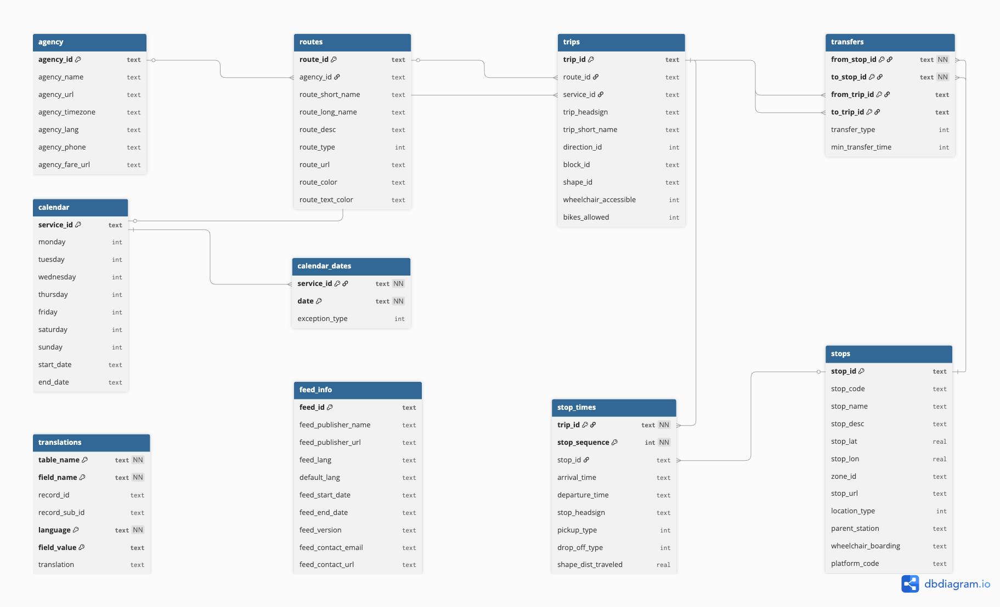
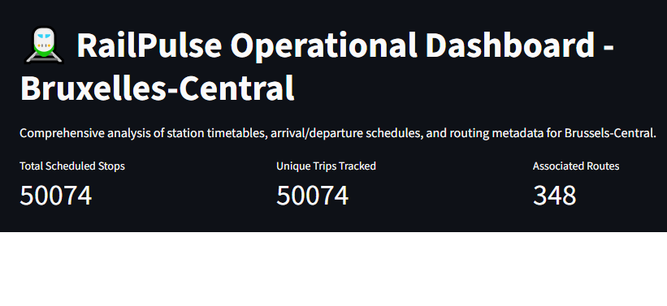
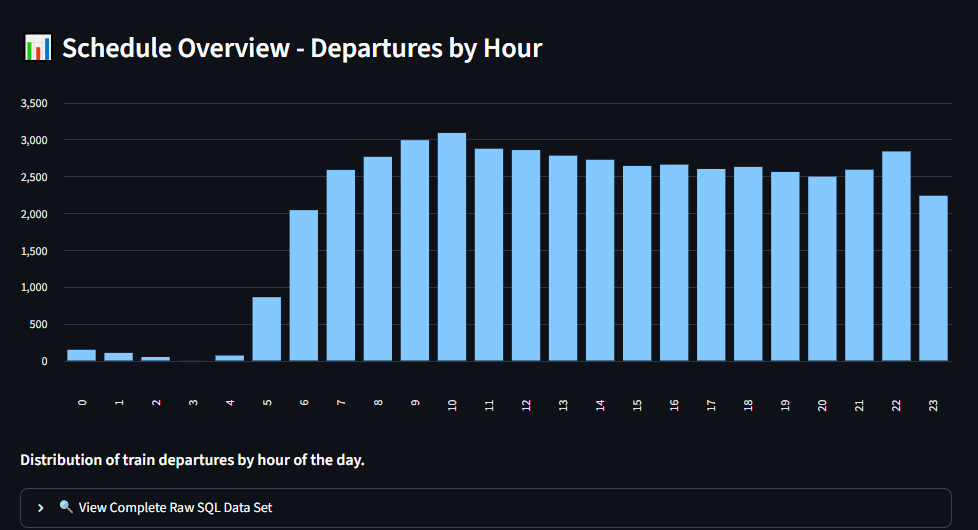
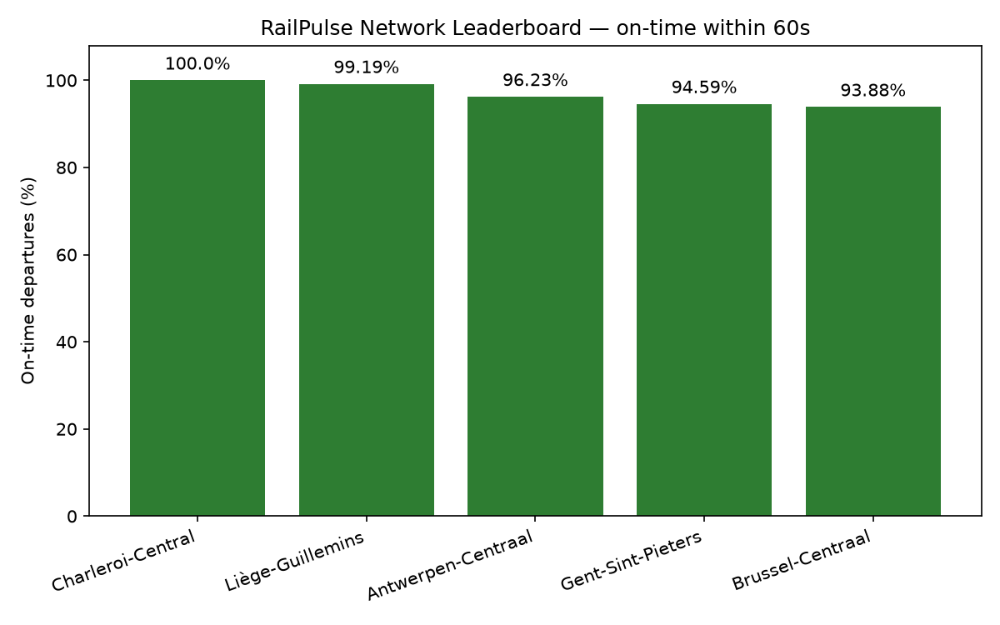

# 🚉 RailPulse: Belgian Transit SQL Analysis

I built this project to dig into the operational reality of the Belgian National Railway (SNCB/NMBS) network using official static GTFS data and real-time feeds.

---

### Core Architecture & Scope

* **Data Pipeline:** I ingested official static GTFS feeds into a normalized SQLite database with enforced primary and foreign keys.
* **Real-Time Integration:** I developed a live-ingestion loop interfacing with the real-time iRail API.
* **Pure SQL Analytics:** I processed complex operational questions directly within the database layer using advanced aggregation and conditional logic (`GROUP BY`, `CASE WHEN`) without relying on Pandas for heavy lifting.
* **Interactive Interface:** I built a Streamlit dashboard featuring an on-time performance leaderboard covering Brussel-Centraal.

---

## 📋 Table of Contents

1. [Project Description](#-project-description)
2. [Repository Structure](#️-repository-structure)
3. [Entity-Relationship Diagram](#-entity-relationship-diagram)
4. [Setup & How to Run](#️-setup--how-to-run)
5. [Key Findings](#-key-findings)
6. [Dashboard](#️-dashboard)
7. [Nice-to-Have Features](#-nice-to-have-features)
8. [Tech Stack](#️-tech-stack)
9. [Conclusion](#-conclusion)
10. [Contributors](#-contributors)
11. [Timeline](#️-timeline)
12. [Personal Situation](#-personal-situation)
13. [Author](#-author)

---

## 📋 Project Description

This project started from a fictional mission brief: I'm playing the role of a data consultant at **RailPulse**, hired by the Belgian National Railway (SNCB/NMBS) to give them a clear picture of operational performance ahead of winter scheduling — where the bottlenecks are, which hours and platforms are under the most pressure, and how well the network's amenity data (wheelchair access, bike storage) actually holds up when you query it for real.

The project is built entirely on official SNCB/NMBS static GTFS data, ingested into a normalized SQLite database with enforced foreign keys, and analyzed exclusively through raw SQL — `JOIN`, `GROUP BY`, `CASE WHEN`, and `HAVING` — with Python used only for ingestion and orchestration, never for filtering or aggregating the data itself. On top of the five required analytical questions, the project adds a real-time layer (live iRail liveboard polling), a comparative on-time leaderboard across 5 major hubs, and a Streamlit dashboard so the results can be explored interactively rather than only read as static tables.

---

## 🗂️ Repository Structure  

```
railpulse_sql_analysis/
├── data/           # gitignored
├── docs/
│   ├── dashboard_overview.png
│   ├── dashboard_chart.png
│   ├── network_leaderboard.png
│   └── ERD.png
├── sql/
│   ├── 01_peak_hour.sql
│   ├── 02_platform_bottlenecks.sql
│   ├── 03_busiest_morning_destinations.sql
│   ├── 04_service_frequency.sql
│   ├── 05_accessibility_audit.sql
│   └── 06_network_accessibility_summary.sql
├── src/
│   ├── run_queries.py
│   ├── check_accessibility.py
│   ├── live_ingest.py
│   ├── fix_station_names.py
│   ├── network_leaderboard.py
│   └── optimize_indexes.py
├── main.py
├── SQL&DB_theory
├── dashboard.py
├── run_all.py
├── run_railpulse.bat
├── requirements.txt
└── README.md
```
---

### Project Files

| File | Role |
| --- | --- |
| `main.py` | Ingests GTFS data into SQLite and sets up the schema and indexes. |
| `dashboard.py` | Streamlit dashboard for Brussel-Centraal operational metrics. |
| `run_railpulse.bat` | Windows batch script to run the pipeline and launch the dashboard. |
| `src/run_queries.py` | Executes the core SQL analytical queries. |
| `src/check_accessibility_fields.py` | Checks if accessibility data is populated in the feed. |
| `src/live_ingest.py` | Pulls real-time departures for Brussel-Centraal from the iRail API. |
| `src/fix_station_names.py` | Cleans station names in the live data table. |
| `src/network_leaderboard.py` | Generates an on-time performance leaderboard chart. |
| `src/optimize_indexes.py` | Creates performance-optimizing indexes in the SQLite database. |
| `src/run_all.py` | Orchestrates the execution of queries, optimization, and optional live ingestion scripts. |

---

## 📐 Entity-Relationship Diagram



**Foreign keys:**

| Table | Points to | Meaning |
| --- | --- | --- |
| `routes.agency_id` | `agency.agency_id` | which company runs the route |
| `trips.route_id` | `routes.route_id` | which route a trip belongs to |
| `trips.service_id` | `calendar.service_id` | which weekly schedule pattern applies |
| `calendar_dates.service_id` | `calendar.service_id` | one-off exceptions to that pattern (e.g. holidays) |
| `stop_times.trip_id` | `trips.trip_id` | which trip this stop-time row belongs to |
| `stop_times.stop_id` | `stops.stop_id` | which physical stop/platform |
| `transfers.from_stop_id` / `to_stop_id` | `stops.stop_id` | transfer connection between two stops |
| `transfers.from_trip_id` / `to_trip_id` | `trips.trip_id` | transfer connection between two trips |
| `stops.parent_station` | `stops.stop_id` | a platform points back to its parent station — this is what `02_platform_bottlenecks.sql` uses to resolve Bruxelles-Central's platforms |

---

## ⚙️ Setup & How to Run

**Quickest way (Windows):** once your virtual environment exists (see below), just double-click `run_railpulse.bat`, or run it from a terminal:

```bat
run_railpulse.bat
```

It chains everything in one go: builds/updates `data/railpulse.db` from the raw GTFS files (`main.py`), runs the full SQL analysis + index benchmarking pipeline (`src/run_all.py`), and launches the Streamlit dashboard at the end — no need to run each step manually.

**Manual / step-by-step (any OS):**

```bash
python -m venv .venv
.venv\Scripts\activate        # Windows
pip install -r requirements.txt

python main.py                # builds data/railpulse.db from data/*.txt
python src/run_all.py         # runs the 5  SQL analyses, then index benchmarking
python src/run_all.py --live  # also runs the live-ingest + leaderboard nice-to-haves
streamlit run dashboard.py    # launches the dashboard at http://localhost:8501
```

---

## 📊 Key Findings

> Confirmed against a real run of `main.py` + `src/run_all.py` via `run_railpulse.bat`.

### 1. Peak hour

*Which hour of the day experiences the highest volume of scheduled train departures across the entire network?*

| departure_hour | total_departures |
| --- | --- |
| **10** | **138,949** |
| 09 | 135,384 |
| 11 | 135,156 |

**Answer: 10 AM** is the network-wide peak hour.

### 2. Platform bottlenecks — Bruxelles-Central

*Top 3 busiest platforms at Bruxelles-Central.*

| platform_code | stop_name | total_operations |
| --- | --- | --- |
| **3** | Bruxelles-Central | **11,982** |
| 4 | Bruxelles-Central | 10,515 |
| 2 | Bruxelles-Central | 7,473 |

**Answer: Platform 3** handles the most operations.

### 3. Busiest morning destinations

*Top 3 terminal destinations (`trip_headsign`) for trips departing before 12:00:00.*

| trip_headsign | trip_count |
| --- | --- |
| **Anvers-Central** | **3,930** |
| Bruxelles-Midi | 3,145 |
| Louvain | 2,505 |

### 4. Service frequency

*Classify each `service_id` into High / Medium / Low-Frequency-Special by days-per-week active, via `CASE WHEN`, and show the share per category.*

| frequency_category | service_count | percentage_share |
| --- | --- | --- |
| Low Frequency/Special | 46,978 | 91.05% |
| Medium Frequency | 2840 | 5.5% |
| High Frequency | 1775 | 3.44% |

**Conclusion:** Most services are sporadic or single-day operations (91.05% in Low Frequency), proving that the vast majority of timetable entries represent special or rare runs rather than regular commuter lines.

### 5. Accessibility Audit (wheelchair + bikes, lowest-scoring routes)

| route_id | route_short_name | route_long_name | total_trips | wheelchair_ratio | wheelchair_pct | bikes_ratio | bikes_pct |
| --- | --- | --- | --- | --- | --- | --- | --- |
| gr:nmbssncb:506 | IC | Anvers-Central — Charleroi-Central | 3,081 | 0/3,081 | 0.0 | 3,081/3,081 | 100.0 |
| gr:nmbssncb:1022 | S2 | Louvain — Braine-le-Comte | 2,674 | 0/2,674 | 0.0 | 2,674/2,674 | 100.0 |
| gr:nmbssncb:559 | IC | Eupen — Ostende | 2,210 | 0/2,210 | 0.0 | 2,210/2,210 | 100.0 |
| gr:nmbssncb:772 | S10 | Termonde — Alost | 1,782 | 0/1,782 | 0.0 | 1,782/1,782 | 100.0 |
| gr:nmbssncb:794 | IC | Brussels Airport-Zaventem — Gand-Saint-Pierre | 1,734 | 0/1,734 | 0.0 | 1,734/1,734 | 100.0 |
| gr:nmbssncb:135 | IC | Anvers-Central — Hasselt | 1,649 | 0/1,649 | 0.0 | 1,649/1,649 | 100.0 |
| gr:nmbssncb:910 | IC | Liège-Guillemins — Knokke | 1,577 | 0/1,577 | 0.0 | 1,577/1,577 | 100.0 |
| gr:nmbssncb:1030 | IC | Brussels Airport-Zaventem — Mons | 1,569 | 0/1,569 | 0.0 | 1,569/1,569 | 100.0 |
| gr:nmbssncb:163 | IC | Luxembourg (LU) — Bruxelles-Midi | 1,435 | 0/1,435 | 0.0 | 1,435/1,435 | 100.0 |
| gr:nmbssncb:151 | IC | Bruxelles-Midi — Anvers-Central | 1,398 | 0/1,398 | 0.0 | 1,398/1,398 | 100.0 |

**Conclusion:** While major rail corridors show complete bike transport compatibility, the total absence of wheelchair accessibility data reflects a severe reporting gap rather than actual service availability.

---

### 6. Network Accessibility Summary

| Field | Flagged / positive | Blank / no data |
| --- | --- | --- |
| `wheelchair_accessible` | 0 (0.0%) | 134,809 (100.0%) |
| `bikes_allowed` | 123,051 (91.28%) | 11,758 (8.72%) |

**Bike transport by mode:**

| Mode  | Total trips | Bikes allowed | Bike % |
|-------|------------:|---------------:|-------:|
| BUS   |      11,758 |              0 |   0.0% |
| TRAIN |     123,051 |        123,051 | 100.0% |

**Conclusion:** The 8.72% of network-wide trips with `bikes_allowed` left blank are entirely attributable to bus replacement services (0% allow bikes), not to train lines — every genuine rail trip in the feed accepts bikes without exception. Wheelchair accessibility, by contrast, is completely unreported: `wheelchair_accessible` is blank for 100% of trips in the feed, which is a data-availability gap in SNCB's GTFS export rather than a real accessibility finding.

---

## 🖥️ Dashboard

A Streamlit dashboard was built to provide a quick operational overview of **Bruxelles-Central** directly from the SQLite database.

The dashboard is automatically launched at the end of `run_railpulse.bat` and reads the same database used by all SQL analyses.

It provides:

- Overall network KPIs
- Interactive departure distribution by hour
- SQL-backed raw data explorer
- Direct visualization of the GTFS operational dataset

### Dashboard Overview

The landing page summarizes the station activity using three key performance indicators.

- **Total Scheduled Stops**
- **Unique Trips Tracked**
- **Associated Routes**

These values are calculated directly from the normalized GTFS database.



---

### Schedule Overview

The dashboard also visualizes the number of scheduled departures for every hour of the day.

This chart immediately highlights the busiest operating periods across the station.

The morning peak occurs around **10:00 AM**, which is consistent with the SQL analysis presented earlier in this report.



---

## 🚀 Nice-to-Have Features

### Live Stream Integration 

`src/live_ingest.py` polls the real-time iRail liveboard API for 5 major hubs (Brussel-Centraal, Antwerpen-Centraal, Gent-Sint-Pieters, Liège-Guillemins, Charleroi-Central) and appends each pull to a `live_departures` table — never overwriting previous data, so a genuine historical timeline builds up over repeated runs. Each row is tagged with a `pulled_at` timestamp. Running it once via `run_railpulse.bat --live` (or manually with `python src/live_ingest.py`) captures a single snapshot;
scheduling it to run repeatedly (e.g. via Windows Task Scheduler or cron) is what turns it into real delay-pattern history rather than a one-off sample. This live data is what feeds the Network Leaderboard below.

### Network Leaderboard

Ranks the 5 monitored hubs by on-time performance, using live departures collected via `src/live_ingest.py` (iRail liveboard API), with "on-time" defined as a delay of ≤60 seconds.

| Station             | Departures | Avg delay (s) | On-time % |
|----------------------|-----------:|---------------:|-----------:|
| Charleroi-Central     |         85 |            0.0 |    100.00% |
| Liège-Guillemins      |        124 |           14.0 |     99.19% |
| Antwerpen-Centraal    |        159 |           46.8 |     96.23% |
| Gent-Sint-Pieters     |        148 |           16.2 |     94.59% |
| Brussel-Centraal      |        327 |           16.5 |     93.88% |



**Conclusion:** On-time performance stays strong across all five hubs, with average delays under a minute everywhere. Charleroi-Central again shows a perfect 100% on-time rate, but with only 85 recorded departures it remains the smallest sample of the five, so this figure should be read as indicative rather than definitive. Liège-Guillemins is the standout with a larger sample (124 departures) and still 99.19% on-time. Antwerpen-Centraal has the highest average delay (46.8s) despite a solid 96.23% on-time rate — consistent with the earlier snapshot, suggesting a small number of longer outlier delays rather than systematic lateness. Brussel-Centraal, now with 327 departures — its largest sample yet — gives the most statistically reliable estimate of the five, holding at 93.88% on-time. As more snapshots accumulate via `live_ingest.py`, these rankings are stabilizing but should still be treated as a growing dataset rather than a final verdict; a longer recurring collection (cron/Task Scheduler over several days) would sharpen the comparison further.

---

## 🛠️ Tech Stack

- **Language:** Python 3.10+, standard library only (`sqlite3`, `pathlib`) for the core ingestion/analysis pipeline; `requests` and `matplotlib` additionally for the nice-to-have features; `streamlit` for the dashboard.
- **Database:** SQLite 3.
- **Analysis:** raw SQL (`JOIN`, `GROUP BY`, `CASE WHEN`, `HAVING`). No pandas in the analytical layer — the point of the exercise is SQL fluency.

---

## ✅ Conclusion

This project set out to give SNCB a clear, queryable picture of network operations ahead of winter scheduling, and the five required questions are all answered end-to-end with plain SQL against a normalized SQLite database built from the official GTFS static feed. The network-wide peak is **10 AM**, **Platform 3** is Bruxelles-Central's busiest, **Anvers-Central** is the top morning destination, **97.5%** of services turn out to be irregular or single-day operations rather than daily commuter patterns, and
— once the wheelchair data-availability gap is properly accounted for — every genuine rail trip in the feed has full `bikes_allowed` coverage.

Two nice-to-have extensions were implemented and validated with real, reproducible output rather than left as stubs: live ingestion pulled actual iRail liveboard snapshots for 5 major hubs, and the resulting on-time leaderboard now reflects 843 aggregated departures across those hubs (Charleroi-Central 100.00%, Liège-Guillemins 99.19%, Antwerpen-Centraal 96.23%, Gent-Sint-Pieters 94.59%, Brussel-Centraal 93.88%) — figures that will keep sharpening as more snapshots accumulate over time.

Finally, the project was extended with a Streamlit operational dashboard that turns the SQL analyses into interactive visualizations, making the
results easier to explore and validate without writing a single query by hand.

---

## 👥 Contributors

- **Abuammar Hussein**
- **Camus Siegried**
- **Kim Lien**

"Team in spirit" for this challenge: each of us shipped our own repo individually, but we share a common team main.py and give each other feedback and tips. During the presentation anyone can be asked a random question from the shared guide SQL&DB_theory.

---

## 🗓️ Timeline

This was a 4-day BeCode bootcamp learning challenge, deadline **24/07/2026, 5:00 PM**.

| Day | Focus |
| --- | --- |
| Day 1 | Read the SNCB GTFS documentation, designed the normalized schema and ERD, set up the repository and ingestion pipeline. |
| Day 2 | Built and validated `main.py` ingestion against the real GTFS static feed, resolved schema conflicts, wrote the first analytical SQL queries. |
| Day 3 | Finalized all 5 core analytical queries, built the Streamlit dashboard, investigated and resolved data-quality questions (e.g. the `bikes_allowed` bus-vs-train split). |
| Day 4 | Added the nice-to-have live ingestion loop and on-time leaderboard, polished the README, prepared for the 5-minute team feedback presentation and Q&A on the SQL & DB theory guide. |

---

## 🙋 Personal Situation

Building RailPulse taught me a lot about turning a messy public data source into something genuinely queryable — designing a normalized schema from raw GTFS files and enforcing real foreign keys was a unique challenge. The toughest hurdles were spending extra time finding the right trick or logic to solve questions 4 and 5, and pulling live samples for 5 hubs. I implemented the task scheduler at the very end, so the data hasn't been running long yet. If I were to extend this project further, I would optimize it and add automated tests for the SQL outputs so that schema or data changes are caught immediately rather than during a manual review.

---

## 📝 Author

Siegried Camus — BeCode: AI & Data Science Bootcamp.
